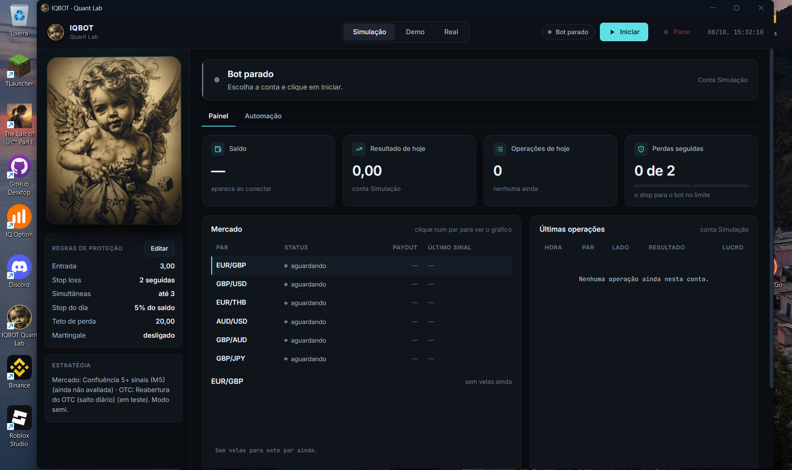

# IQBOT Quant Lab

<p align="center">
  
  
  
  
  
</p>

<p align="center">
  
</p>

Plataforma de trading algorítmico e pesquisa quantitativa em Python para opções binárias da IQ Option, com interface desktop, automação de estratégias e validação estatística.

O foco do projeto é **medir antes de acreditar**: toda estratégia passa por backtest com a mesma função de decisão usada ao vivo, por intervalo de confiança e por correção para múltiplos testes antes de poder operar.

> **Aviso:** projeto de estudo. Opções binárias têm retorno esperado negativo para quem opera (o payout é menor que 100%) e a maioria das estratégias testadas aqui ficou em torno de 50% de acerto. Nada neste repositório é recomendação de investimento. Use a conta **demo (PRACTICE)**.

## Funcionalidades

- **Conexão em tempo real** com a IQ Option via WebSocket (`iqoptionapi`), com limite de tempo em cada chamada, reconexão e 2FA pela interface.
- **Interface desktop** (pywebview + HTML/CSS/JavaScript) servida por uma API HTTP local com token: painel ao vivo, gráfico de velas, operações, automação e edição das regras de risco.
- **Gestão de risco** configurável: entrada fixa, operações simultâneas, stop por perdas seguidas, perda máxima por sessão e por dia (em R$ ou %), teto de perda total e kill switch (arquivo `STOP`).
- **Automação**: detecta a fase do mercado (pares de mercado, OTC, misto ou fechado), reavalia as estratégias em segundo plano e troca de plano sem interromper a operação.
- **Motor de backtest e avaliação** (pandas/NumPy): testa cada estratégia em cada par nos últimos 30 dias e só aprova com regras fixas — mínimo de operações, significância após correção de Benjamini-Hochberg, estabilidade nas duas metades do período e últimos 7 dias.
- **Estratégias**: reversão de 5 min, táticas de quadrante (MHI, Milhão…), confluência de 7 sinais de reversão, humor dos traders e a "reabertura" diária do OTC.
- **Testes automatizados** (pytest) com uma corretora falsa, incluindo teste de equivalência entre backtest e execução ao vivo e testes de ausência de look-ahead.

## Arquitetura

| Camada | Arquivos |
|---|---|
| Interface | `app.py`, `interface/` |
| Ciclo do bot | `main.py`, `executor.py`, `risk.py`, `trava.py` |
| Automação | `mercado.py`, `seletor.py`, `catalogo.py`, `avaliador.py`, `reabertura.py` |
| Estratégias e dados | `strategy.py`, `indicators.py`, `data.py`, `backtest.py`, `stats.py` |
| Conexão | `connection.py`, `fake_broker.py`, `news.py` |
| Pesquisa offline | `pesquisa.py`, `strategy_lab.py`, `edge_finder.py`, `dukascopy.py`, `sintetico.py` |

## Instalação (Windows 11)

Pensada para o Windows 11 com o **Controle Inteligente de Aplicativos** (Smart App Control) ligado. Ele bloqueia arquivos baixados que não têm assinatura digital (`.exe`, `.bat`, `pythonw.exe`). Por isso o projeto não usa nenhum deles: tudo roda pelo `python.exe` oficial, que é assinado.

**1. Instale o Python** (só uma vez)

Baixe em [python.org/downloads](https://www.python.org/downloads/) a versão 3.10 ou mais nova. Na primeira tela do instalador, marque **"Add python.exe to PATH"**.

**2. Baixe e extraia o bot**

1. Neste repositório: **Code → Download ZIP**.
2. Botão direito no ZIP → **Extrair tudo** → **Extrair**.
3. Abra a pasta extraída. Se dentro dela houver **outra pasta com o mesmo nome**, entre nela: a pasta certa é a que tem o `instalar.py`.

**3. Instale**

Dê **dois cliques em `instalar.py`**. Uma janela preta mostra o progresso (alguns minutos). No fim ela cria o ícone **IQBOT Quant Lab** na Área de Trabalho e pergunta se quer abrir o app.

> Se o Windows perguntar com qual programa abrir, escolha **Python**. Se o `instalar.py` abrir no Bloco de Notas, use o plano B abaixo.

**Plano B (pelo CMD, sem precisar digitar caminho):** na pasta do bot, clique na **barra de endereço** do Explorador de Arquivos, apague o que estiver escrito, digite `cmd` e aperte Enter. Na janela que abrir, digite:

```
python instalar.py
```

**4. Use**

- Dois cliques no ícone **IQBOT Quant Lab** da Área de Trabalho. Escolha **Simulação** para testar sem conta.
- Para a conta demo: abra o `.env` no Bloco de Notas e coloque o seu e-mail e senha da IQ Option. Esse arquivo nunca vai para o Git.
- Pelo CMD (na pasta do bot): `venv\Scripts\python.exe app.py`

### Se algo der errado

| Problema | Solução |
|---|---|
| `python` não é reconhecido | Reinstale o Python marcando **"Add python.exe to PATH"** e abra um CMD novo. |
| `can't open file ... instalar.py` | O CMD está na pasta errada (normalmente a de fora). Entre na pasta que tem o `instalar.py`. |
| O ícone não apareceu | Botão direito na Área de Trabalho → **Novo → Atalho** e cole (troque pelo caminho da sua pasta):<br>`"C:\caminho\do\bot\venv\Scripts\python.exe" "C:\caminho\do\bot\app.py" --oculto`<br>Em **Propriedades**: *Iniciar em* = pasta do bot; *Alterar Ícone* = `interface\assets\anjo.ico`. Dica: no CMD, dentro da pasta, `echo "%CD%\venv\Scripts\python.exe" "%CD%\app.py" --oculto` mostra a linha pronta. |
| "Este aplicativo foi bloqueado" | Não use `pythonw.exe` nem arquivos `.bat`: o atalho deve apontar para o `python.exe` do venv, como acima. |
| A janela do app não abre | `venv\Scripts\python.exe app.py --browser` abre no navegador. O motivo fica em `logs\interface_erro.log`. |

> A biblioteca de conexão com a IQ Option ([iqoptionapi](https://github.com/iqoptionapi/iqoptionapi)) não está no PyPI, então o instalador a baixa direto do repositório dela no GitHub.

**Instalação manual (opcional):**

```
python -m venv venv
venv\Scripts\python.exe -m pip install -r requirements_interface.txt
venv\Scripts\python.exe -m pip install -U https://github.com/iqoptionapi/iqoptionapi/archive/refs/heads/master.zip
venv\Scripts\python.exe -m pip install websocket-client==0.56.0
copy .env.exemplo .env
copy config.exemplo.yaml config.yaml
```

## Como usar

- **Interface:** ícone da Área de Trabalho (ou dois cliques em `abrir_iqbot.pyw`). Escolha Simulação, Demo ou Real e clique em Iniciar.
- **Linha de comando:** `venv\Scripts\python.exe main.py` · simulação sem conta: `venv\Scripts\python.exe main.py --simular`.
- **Parar com segurança:** botão Parar no app, ou crie um arquivo chamado `STOP` na pasta do bot.
- **Testes:** `venv\Scripts\python.exe -m pytest -q`.

Mais detalhes em `LEIA_PRIMEIRO_INTERFACE.md`, `LEIA_PRIMEIRO_AUTOMACAO.md` e `docs/GUIA_COMPLETO.md`.

## Resultados da pesquisa (30 dias de velas de 1 min)

- **OTC:** 16 regras de vela, 9 táticas de quadrante e o humor dos traders ficaram entre 49,7% e 50,3% de acerto, em 1,5 milhão de velas de 37 pares — o preço OTC se comporta como aleatório.
- **Pares de mercado:** efeitos de reversão pequenos e reais (51% a 53%); a confluência de 5 ou mais sinais chegou a 57% em pares aprovados, perto do empate de ~54%.
- **Lição principal:** escolher par ou estratégia pelos melhores resultados recentes é a armadilha mais comum — as 20 melhores combinações em 20 dias caíram de 52,8% para 50,3% nos 10 dias seguintes.

## Tecnologias

Python · pandas · NumPy · SQLite · WebSocket · multithreading · pytest · pywebview · JavaScript · HTML · CSS · estatística aplicada (Wilson, Benjamini-Hochberg) · backtesting.
